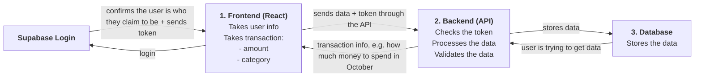

# Finance Tracker
 
## Summary
 
This is a finance tracker. What it will do is that a user will log in and will enter a transaction. The transaction will go and be processed, then will be stored in the database. When the user wants to know or view his transactions, he can make requests to the database, and it will be processed and then received. The database will show that data.
 
## How login works
 
The frontend talks to Supabase to make sure the user is logged in. Supabase gives back a token. The frontend sends that token to the backend through the API, so the backend can make sure the person is allowed in.
 
## Flow Diagram
 

 
## Plain text version
 
```
                         +--------------------+
                         |   Supabase Login   |
                         +--------------------+
                           ^                |
                     login |                | confirms the user is who they
                           |                | claim to be + sends token
                           |                v
+-----------------------+       +---------------------+       +------------------+
|  1. Frontend (React)  |       |  2. Backend (API)   |       |   3. Database    |
|                       |       |                     |       |                  |
|  - User info          | ----> |  - Check the token  | ----> |  - Store data    |
|  - Transaction:       |       |  - Process data     |       |                  |
|      - amount         | <---- |  - Validate data    | <---- |                  |
|      - category       |       |                     |       |                  |
+-----------------------+       +---------------------+       +------------------+
 
  Frontend --> Backend : sends data + token through the API
  Backend --> Frontend : transaction info (e.g. how much money to spend in October)
  Database --> Backend : when the user is trying to get data from the database
```
 
## Rules: what each tier must never do
 
1. **Frontend:** The frontend must never talk to the database directly.
2. **Backend:** The backend should never be exposed to the client. It is only exposed through its APIs.
3. **Database:** The database should not accept requests or queries directly from the client.
 